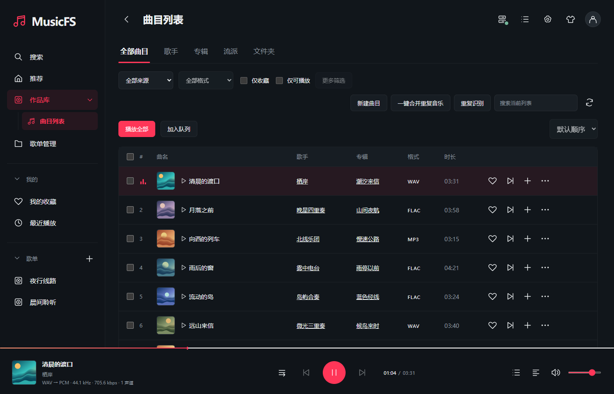
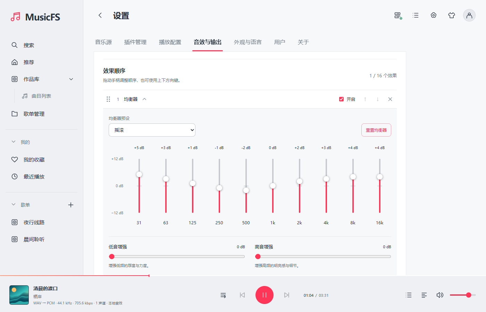

# MusicFS Web

简体中文 · [English](docs/README.en.md)

MusicFS 的浏览器播放器。连接自己的 MusicFS Server 后，可以按歌手、专辑、流派或文件夹浏览音乐，整理歌单和收藏，并在切换页面时继续播放。



*截图使用演示曲库，曲名、音频和封面均为示例。*

## 播放第一首曲目

1. 启动 MusicFS Server 并打开它提供的 Web 地址，用服务端配置的管理员令牌登录。[服务端运行指南](https://github.com/fnMrRice/MusicFS-server/blob/main/docs/operations/running.md)
2. 在「设置 → 音乐源」选择「添加本地目录」，勾选**服务器上的音乐文件夹**，点击「添加所选目录」。保存后会自动扫描。
3. 打开「作品库 → 曲目列表」，点击曲名播放。底栏可调整进度和音量，也能打开队列。已配置相应服务端插件的实例还可播放本地 NCM 文件。[NCM 配置](https://github.com/fnMrRice/MusicFS-server/blob/main/docs/playback/ncm.md)

在「设置 → 音效与输出」中可试听十段均衡器、增益、压缩和混响。保存后的音效按浏览器、服务端实例和账号保留。[音效与输出设置](docs/dsp-settings.md)

<details>
<summary>查看十段均衡器截图</summary>



</details>

## 本地开发

使用 Node.js 26.3.1 和 npm 11.16.0，在 Web 仓库根目录启动开发服务。

```sh
npm ci
npm run dev
```

打开 `http://127.0.0.1:5173`。Vite 默认将 `/api` 代理至 `http://127.0.0.1:8080`。在 Server 的 `allowedOrigins` 中加入开发页面地址。若 Server 使用其他地址，请在运行 Vite 前设置 `MUSICFS_DEV_SERVER`。

```sh
npm test
npm run build
```

构建会执行 TypeScript 类型检查并生成 `dist/`。可使用 Server 的 `--web-root` 托管该目录，或将静态文件和 `/api` 部署在同一来源。浏览器集成测试的依赖和命令见[测试指南](tests/README.md)。

本项目几乎完全由 AI 生成。[许可证](LICENSE)
