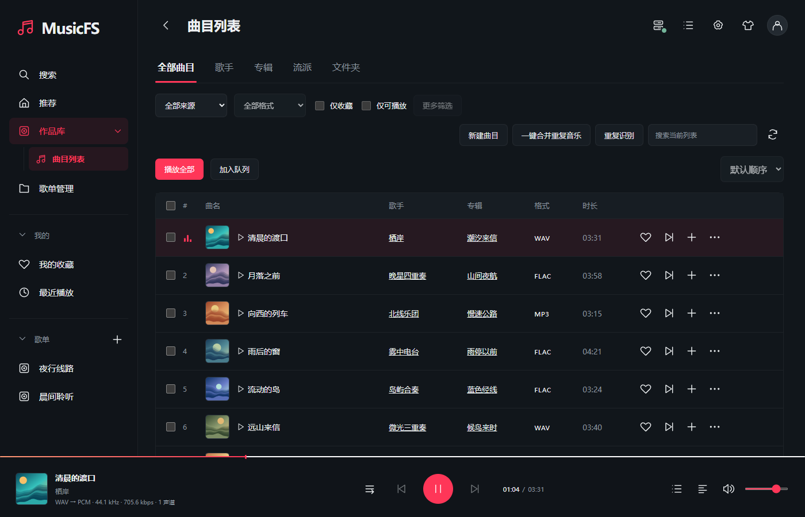
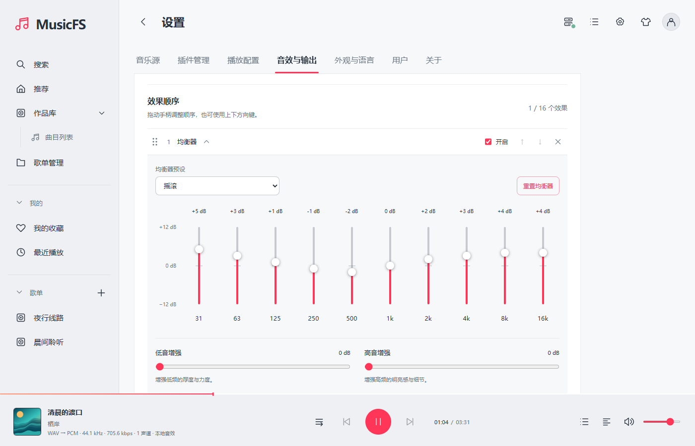

# MusicFS Web

[简体中文](../README.md) · English

MusicFS Web is a browser player for your MusicFS Server. Browse music by artist, album, genre, or folder, organize playlists and favorites, and keep listening as you move between pages.



*The screenshots show a demo library with sample titles, audio, and artwork.*

## Play your first track

1. Start MusicFS Server, open the Web address it serves, and sign in with the administrator token configured on the server. [Server setup guide](https://github.com/fnMrRice/MusicFS-server/blob/main/docs/operations/running.md)
2. In **Settings → Music sources**, choose **Add local folder**, select a **music folder on the server**, and click **Add selected folder**. The server scans it automatically.
3. Open **Library → Tracks** and click a title to play it. Use the bottom bar to seek, change volume, or open the queue. Local NCM files can also be played when the required server plugins are configured. [NCM configuration](https://github.com/fnMrRice/MusicFS-server/blob/main/docs/playback/ncm.md)

In **Settings → Effects & output**, you can hear changes to the ten-band equalizer, gain, compression, and reverb as you make them. The browser saves effects separately for each server and account. [Effects and output settings](dsp-settings.md)

<details>
<summary>Show the ten-band equalizer</summary>



</details>

## Local development

Use Node.js 26.3.1 and npm 11.16.0. Start the development server from the Web repository root.

```sh
npm ci
npm run dev
```

Open `http://127.0.0.1:5173`. Vite proxies `/api` to `http://127.0.0.1:8080` by default. Add the development page's origin to the server's `allowedOrigins`. If the server uses a different address, set `MUSICFS_DEV_SERVER` before starting Vite.

```sh
npm test
npm run build
```

The build runs the TypeScript checker and writes static files to `dist/`. Serve that directory with the server's `--web-root` option, or serve the static files and `/api` from the same origin. The browser integration tests and their prerequisites are covered in the [test guide](../tests/README.md).

This project was generated almost entirely by AI. [License](../LICENSE)
